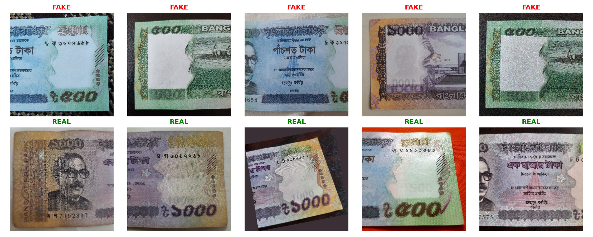
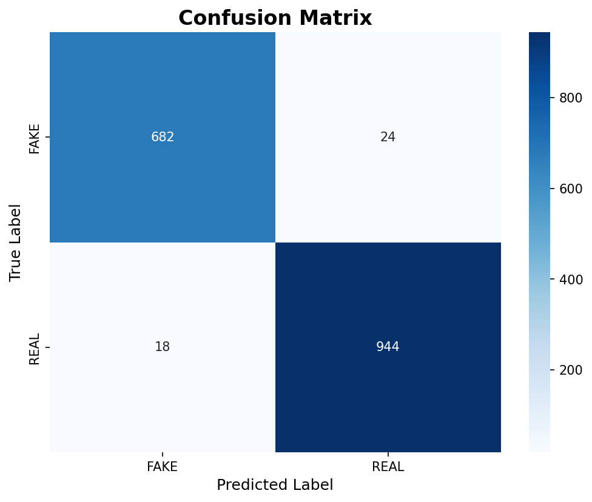
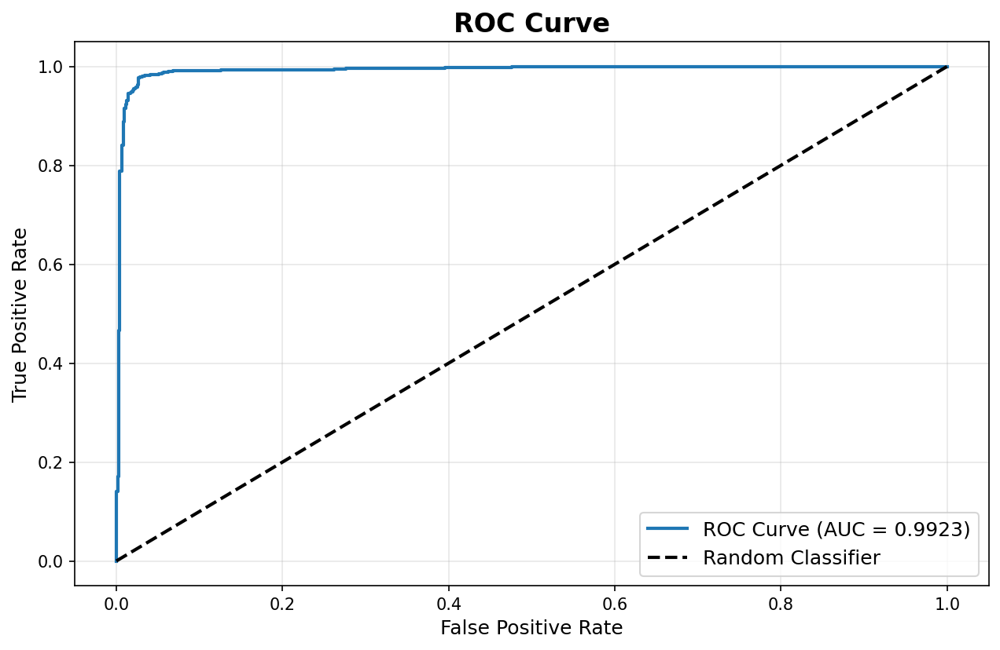
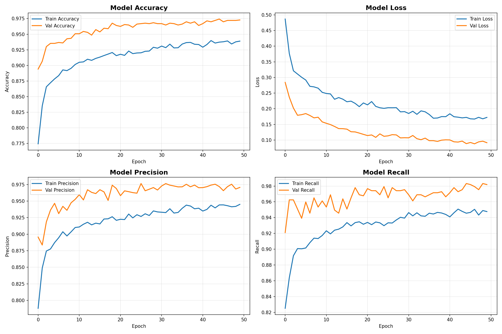
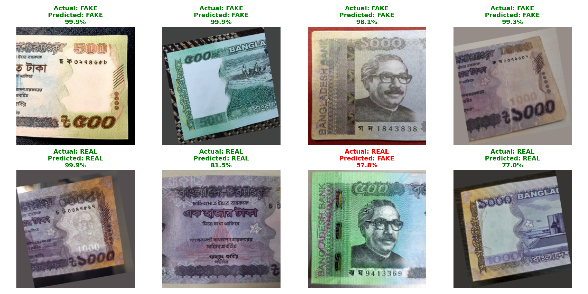

# Bangladeshi Banknote Authentication System

**Computer vision · MobileNetV2 · TensorFlow/Keras · Flask**

A banknote-image classification prototype that distinguishes **FAKE** and **REAL** Bangladeshi banknotes using transfer learning. The repository includes dataset preparation, model training, evaluation notebooks, a saved model, original research figures, and a Flask image-upload interface.

[Explore the project and image gallery](https://shahriar811.github.io/mdshahriarhossain.github.io/projects/banknote-authentication.html) · [Recorded classification report](classification_report.txt) · [Training history](training_history.json)

## At a glance

| Item | Recorded value |
| --- | --- |
| Backbone | ImageNet-pretrained **MobileNetV2** |
| Input | **224 × 224 RGB** |
| Output classes | **FAKE / REAL** |
| Source image pool | **6,794 images** |
| Test set | **1,668 images** |
| Recorded test accuracy | **97.48%** |
| Recorded weighted F1 | **0.9748** |
| Recorded ROC AUC | **0.9923** |
| Saved model | `model/banknote_classifier.h5` |

These metrics reproduce saved evaluation outputs. Dataset counts and training-history files come from distinct artifacts; their differences are documented below.

## Pipeline

1. Collect labelled banknote photographs and prepare training/validation folders.
2. Convert images to RGB, resize to 224 × 224, and rescale pixel values by `1/255`.
3. Apply augmentation during training.
4. Extract features with a frozen MobileNetV2 backbone.
5. Train a dense classification head with a sigmoid output.
6. Evaluate predictions using classification reports, a confusion matrix, and ROC analysis.
7. Load the saved model in a Flask notebook to classify uploaded images.


The pipeline is an illustration. The plots and sample predictions below are saved project outputs.

## Model architecture

The training notebook uses `MobileNetV2(weights="imagenet", include_top=False)` with the backbone frozen. The classifier contains:

```text
224 × 224 × 3 image
  → MobileNetV2 feature extractor
  → GlobalAveragePooling2D
  → BatchNormalization → Dropout(0.5)
  → Dense(128, ReLU) → BatchNormalization → Dropout(0.3)
  → Dense(64, ReLU) → Dropout(0.2)
  → Dense(1, sigmoid)
```

The saved model summary records **175,105 trainable parameters**. Training uses Adam (`learning_rate=0.001`), binary cross-entropy, batch size 32, and up to 50 epochs. Callbacks include early stopping, a best-validation-accuracy checkpoint, and learning-rate reduction.

Augmentation includes rotation, horizontal/vertical shifts, shear, zoom, and horizontal flips. The recorded class mapping is `fake: 0` and `real: 1`; inference uses a threshold of `0.5`.

## Dataset records

| Record | Fake | Real | Total |
| --- | ---: | ---: | ---: |
| Source pool in preparation notebook | 2,933 | 3,861 | **6,794** |
| Proposed training split | 2,346 | 3,088 | **5,434** |
| Proposed validation split | 587 | 773 | **1,360** |
| Evaluation test set | 706 | 962 | **1,668** |

The preparation notebook proposes an 80/20 split of the source pool. The training notebook instead logs **6,794 training images** and **1,360 validation images**. These records are reproduced separately and are not added together as a unique dataset total.

The source path is named `Dataset`, while the preparation output path is named `dataset`. On a case-insensitive file system such as a typical Windows installation, those names refer to the same directory. When reproducing the split, use distinct source/output folder names, update the notebook paths, and check that training and validation images do not overlap.



## Recorded evaluation results

The evaluation notebook reports results on **1,668 test images**.

| Metric | Saved value |
| --- | ---: |
| Accuracy | **97.48%** |
| Weighted precision | 0.9748 |
| Weighted recall | 0.9748 |
| Weighted F1 | **0.9748** |
| ROC AUC | **0.9923** |

| Class | Precision | Recall | F1 | Test images |
| --- | ---: | ---: | ---: | ---: |
| FAKE | 0.9743 | 0.9660 | 0.9701 | 706 |
| REAL | 0.9752 | 0.9813 | 0.9782 | 962 |

The binary F1 printed for the positive REAL class is **0.9782**; the weighted F1 across both classes is **0.9748**.

The saved confusion matrix is:

| True / predicted | FAKE | REAL |
| --- | ---: | ---: |
| FAKE | **682** | 24 |
| REAL | 18 | **944** |





These are recorded experiment results. Split consistency and overlap cannot be established from the saved counts alone; verify the data split when reproducing the experiment.

## Training and prediction figures



The history artifact contains **50 epochs** of training/validation metrics. The training notebook also contains a different validation summary, so the history and evaluation outputs should not be assumed to describe one consistent run.



The sample grid retains the original actual/predicted labels, including a misclassified example. Additional augmentation and report figures are available in the repository root.

## Repository structure

```text
data_preparation.ipynb   Source inspection and proposed train/validation split
model_training.ipynb    MobileNetV2 training and model export
model_evaluation.ipynb  Test predictions, metrics, confusion matrix, and ROC
flask_webapp.ipynb      Local Flask upload interface and prediction route
model/
  banknote_classifier.h5
classification_report.txt
training_history.json
sample_images.png
augmented_samples.png
prediction_samples.png
confusion_matrix.png
roc_curve.png
training_history.png
generate_report_charts.py
uploads/                Images used by the Flask workflow
```

## Run the Flask demo

### 1. Clone and prepare an environment

```powershell
git clone https://github.com/Shahriar811/Bangladeshi-Banknote-authentication-system.git
cd Bangladeshi-Banknote-authentication-system
python -m venv .venv
.\.venv\Scripts\Activate.ps1
python -m pip install tensorflow flask pillow numpy matplotlib seaborn scikit-learn jupyter
jupyter notebook
```

Use a Python environment compatible with TensorFlow and the saved Keras model.

### 2. Configure and run the notebook

Open `flask_webapp.ipynb` and change its hardcoded `PROJECT_DIR` to the absolute path of your cloned repository. Confirm that `MODEL_PATH` resolves to `model/banknote_classifier.h5`, then run the cells in order.

Open [http://127.0.0.1:5000/](http://127.0.0.1:5000/) and upload a PNG, JPG, or JPEG. The Flask app accepts uploads up to 16 MB and returns the predicted label and model confidence.

Keep the notebook kernel running while using the app. Restarting the kernel stops its background Flask thread.

| Method | Route | Purpose |
| --- | --- | --- |
| GET | `/` | Image-upload interface |
| POST | `/predict` | Multipart image upload using the `file` field |

The JSON response contains `result`, `confidence`, and `filename`.

## Reproduce training and evaluation

1. Supply the dataset separately; the complete training/test dataset is not in this repository.
2. Update `PROJECT_DIR`, source folders, and preparation output folders in the notebooks. Use distinct source and prepared-data directory names.
3. Run `data_preparation.ipynb`, checking image counts and split overlap.
4. Run `model_training.ipynb` to train and save `model/banknote_classifier.h5`.
5. Run `model_evaluation.ipynb` using your test folder to produce new metrics and figures.
6. Run `flask_webapp.ipynb` to test the resulting model through the browser.

**Md. Shahriar Hossain** · [GitHub](https://github.com/Shahriar811) · [Portfolio](https://shahriar811.github.io/mdshahriarhossain.github.io/)
